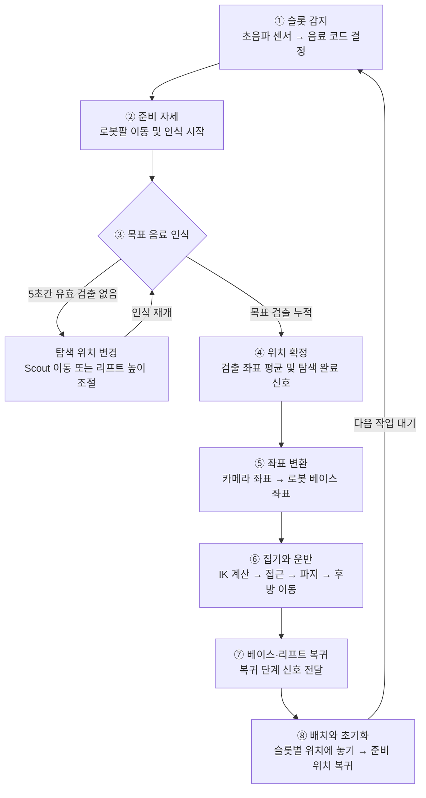
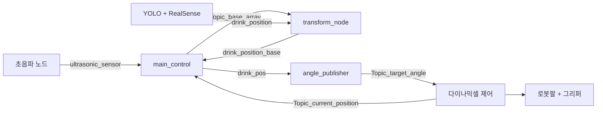

# 진열이

**음료 인식부터 탐색·집기·운반·배치까지 연동하는 ROS 2 기반 이동형 로봇 시스템**

초음파 센서로 작업 대상 슬롯을 감지하고, YOLO·RealSense로 목표 음료의 3차원 위치를 구합니다. Scout 이동형 베이스와 리프트가 탐색 위치를 조절하고, 다이나믹셀 로봇팔이 음료를 집어 지정된 위치로 옮깁니다.

> 소스 코드에 구성된 작업 절차를 정리한 문서입니다. 실제 구동 전에 확인해야 할 누락 파일과 구현 문제는 [현재 구현 상태](#현재-구현-상태)에 정리했습니다.

## 목차

- [전체 동작 흐름](#전체-동작-흐름)
- [패키지 구성](#패키지-구성)
- [노드 연결 구조](#노드-연결-구조)
- [주요 토픽과 제어 코드](#주요-토픽과-제어-코드)
- [인식과 기구학](#인식과-기구학)
- [실행 구성](#실행-구성)
- [현재 구현 상태](#현재-구현-상태)

## 전체 동작 흐름



| 단계 | 담당 노드 | 처리와 다음 단계 조건 |
| --- | --- | --- |
| ① 슬롯 감지 | `ultrasonic_node` → `main_control` | 센서 번호 `1~6`을 음료 코드 `0~5`로 바꾸고, 대기 상태에서 작업을 시작합니다. |
| ② 준비 자세 | `angle_publisher` | 현재 관절각을 받아 인식용 자세로 이동합니다. `angle_sign=4`를 받으면 메인이 `drink_code=11`로 인식을 시작합니다. |
| ③ 탐색 | `Yolo_RealSense_Node`, `Scout_node`, `linear_node` | 검출 타임아웃이면 `scout_control=22`를 보냅니다. 탐색 구역에 따라 베이스·리프트를 움직인 뒤 `scout_realsense=44`로 인식을 재개합니다. |
| ④ 위치 확정 | `Yolo_RealSense_Node` | 유효 좌표를 평균해 `drink_position`으로 발행하고 `scout_control=21`을 보냅니다. 메인은 `next_step1=10,20`을 모두 기다립니다. |
| ⑤ 좌표 변환 | `main_control`, `transform_node` | 현재 관절각으로 카메라 변환행렬을 구합니다. 음료를 베이스 좌표로 변환한 뒤 `drink_pos`로 팔 계획 노드에 전달합니다. |
| ⑥ 집기·운반 | `angle_publisher`, `dynamixel_ax_controller` | `drink_code=12`와 목표 좌표로 집기를 진행합니다. 접근·파지·들어 올리기·후방 이동 후 `angle_sign=11`을 보냅니다. |
| ⑦ 복귀 | `Scout_node`, `linear_node` | `drink_code=13`을 받아 구역에 맞는 복귀 동작을 수행하도록 구성되어 있습니다. 메인은 `next_step1=30,40`을 기다립니다. |
| ⑧ 배치·초기화 | `angle_publisher`, `main_control` | `drink_code=14`를 받은 팔이 음료 코드별 위치에 내려놓고 준비 위치로 돌아옵니다. `angle_sign=15`를 받으면 메인 상태를 초기화합니다. |

완료 신호와 실제 하드웨어 완료 시점이 일치하지 않는 경로가 있습니다. 탐색 완료·복귀·리프트의 제한사항은 [현재 구현 상태](#현재-구현-상태)를 확인하세요.

## 패키지 구성

```text
2025ESWContest_free_SOOMAC/
├── src/
│   ├── robot_control_pkg/    # 작업 관리, 기구학, 다이나믹셀
│   ├── camtest_pkg/          # 음료 인식, 좌표 변환, Scout 이동
│   ├── linear_motor/         # 리프트 제어와 Arduino 펌웨어
│   └── ultrasonic_pkg/       # 슬롯 감지, GUI 인터페이스와 펌웨어
├── build/                    # 기존 환경의 빌드 결과
├── install/                  # 기존 환경의 설치 결과
├── log/                      # 과거 빌드 로그
└── README.md
```

각 패키지는 `package.xml`, `setup.py`, `setup.cfg`, `resource/`, `test/`를 갖습니다. 실제 노드는 **패키지 안의 같은 이름을 가진 Python 디렉터리**에 있습니다. 예: `src/robot_control_pkg/robot_control_pkg/main_control.py`.

### robot_control_pkg — 작업 관리와 로봇팔

| 파일 | 역할 |
| --- | --- |
| [main_control.py](src/robot_control_pkg/robot_control_pkg/main_control.py) | 작업 상태를 관리하고 센서·팔·베이스·리프트의 신호를 연결합니다. 카메라 변환행렬 계산과 운반 중 그리퍼 전류 기반 낙하 판별도 담당합니다. |
| [angle_publisher.py](src/robot_control_pkg/robot_control_pkg/angle_publisher.py) | 목표 위치의 IK를 계산하고 준비·접근·파지·운반·배치를 진행합니다. 목표 각도와 팔의 진행 상태를 발행합니다. |
| [dynamixel_ax_controller.py](src/robot_control_pkg/robot_control_pkg/dynamixel_ax_controller.py) | 모터 ID `1, 2, 3, 4, 10`을 제어하고 현재 각도와 ID 10의 그리퍼 전류를 발행합니다. |
| [motor_test.py](src/robot_control_pkg/robot_control_pkg/motor_test.py) | 고정 각도를 보내는 독립 시험 코드입니다. 파일 최상위에서 포트를 열고 모터를 구동합니다. |

패키지의 `robot_control_pkg.zip`에는 `angle_publisher_2.py`, `dynamixel_ax_controller_2.py` 등 별도 버전 소스가 있습니다. ZIP 내부 파일은 현재 Python 패키지의 실행 모듈로 사용할 수 없습니다.

### camtest_pkg — 인식·좌표 변환·이동

| 파일 | 역할 |
| --- | --- |
| [Yolo_RealSense_Node.py](src/camtest_pkg/camtest_pkg/Yolo_RealSense_Node.py) | YOLO 분할과 RealSense 깊이로 음료 위치를 구합니다. 일부 캔은 Google Cloud Vision OCR로 제로콜라 여부를 판별하며, 검출 성공·실패 신호로 탐색을 제어합니다. |
| [transform_node.py](src/camtest_pkg/camtest_pkg/transform_node.py) | 카메라 기준 음료 좌표와 4×4 변환행렬을 받아 베이스 기준 좌표를 발행합니다. |
| [Scout_node.py](src/camtest_pkg/camtest_pkg/Scout_node.py) | 구역별 전후 이동을 `/cmd_vel`로 명령하고 리프트 높이 변경과 복귀 단계를 연동합니다. |

### linear_motor — 리프트

| 파일 | 역할 |
| --- | --- |
| [linear_node.py](src/linear_motor/linear_motor/linear_node.py) | ROS 명령을 Arduino 시리얼 명령으로 바꾸고 높이 상태·인식 재개·단계 신호를 발행합니다. |
| [lift_arduino.ino](src/linear_motor/linear_motor/lift_arduino/lift_arduino.ino) | 방향 핀과 PWM으로 리니어 모터를 구동합니다. 시리얼 `33`은 상승, `44`는 하강입니다. |

### ultrasonic_pkg — 슬롯 감지와 GUI 인터페이스

| 파일 | 역할 |
| --- | --- |
| [ultrasonic_node.py](src/ultrasonic_pkg/ultrasonic_pkg/ultrasonic_node.py) | Arduino에서 받은 숫자 센서 번호를 `ultrasonic_sensor`로 발행합니다. |
| [ultrasonic_arduino.ino](src/ultrasonic_pkg/ultrasonic_pkg/ultrasonic_arduino/ultrasonic_arduino.ino) | 센서 6개를 읽습니다. 거리 23~30cm를 3회 연속 확인하면 센서 번호를 출력하고 10초 쿨다운을 적용합니다. |
| [GUI_node.py](src/ultrasonic_pkg/ultrasonic_pkg/GUI_node.py) | 음료·낙하·재고를 구독하고 IN/OUT·재고 초기화 이벤트를 발행합니다. 실제 GUI 화면은 포함되어 있지 않습니다. |
| [GUI_arduino.ino](src/ultrasonic_pkg/ultrasonic_pkg/GUI_arduino/GUI_arduino.ino) | 재고와 IN/OUT 명령 처리를 위한 코드입니다. ROS 토픽과 시리얼을 연결하는 노드는 현재 없습니다. |

## 노드 연결 구조

아래는 핵심 데이터 경로입니다. 단계 전환용 토픽은 다음 절의 표에 정리했습니다.



## 주요 토픽과 제어 코드

토픽 이름은 기본 네임스페이스 기준입니다. 배열은 별도 사용자 정의 메시지 없이 `Float32MultiArray`로 전달합니다.

### 위치·상태 데이터

| 토픽 | 메시지 | 발행 → 구독 | 내용 |
| --- | --- | --- | --- |
| `/ultrasonic_sensor` | `Int32` | 초음파 → 메인 | 센서 번호 `1~6` |
| `/drink_position` | `Float32MultiArray` | 인식 → 좌표 변환 | 카메라 축을 재배열한 좌표 `[z, -y, x]`, cm |
| `/Topic_base_array` | `Float32MultiArray` | 메인 → 좌표 변환 | 카메라→베이스 4×4 행렬을 행 순서로 펼친 16개 값 |
| `/drink_position_base` | `Float32MultiArray` | 좌표 변환 → 메인 | 베이스 기준 음료 좌표 `[x, y, z]`, cm |
| `/drink_pos` | `Float32MultiArray` | 메인 → 팔 계획 | 집기 대상 좌표, cm |
| `/Topic_target_angle` | `Float32MultiArray` | 팔 계획 → 모터 제어 | 모터 5개의 목표 각도, degree |
| `/Topic_current_position` | `Float32MultiArray` | 모터 제어 → 메인·팔 계획 | 모터 5개의 현재 각도, degree |
| `/Topic_current` | `Float32` | 모터 제어 → 메인 | 그리퍼 전류 환산값, mA |
| `/cmd_vel` | `Twist` | Scout 노드 → 외부 베이스 드라이버 | 이동 속도 명령 |
| `/lift_position` | `Bool` | 리프트 → 팔 계획 | `False` 하단, `True` 상단 |
| `/stop_process` | `Bool` | 메인 → GUI | 낙하 의심 알림. 현재 모터 정지 동작과 연결되지 않음 |

### 작업 제어 신호

아래 토픽은 `/angle_sign`을 포함해 모두 `Int32`를 사용합니다.

| 토픽 | 코드 | 의미 |
| --- | --- | --- |
| `/drink_code` | `0~5` | 목표 클래스: `Ddcan`, `Ycan`, `cass`, `pocari`, `samdasoo`, `zero_cola` |
| | `11` | 최초 인식 시작 |
| | `12` | 팔의 집기 단계 진행 허용 |
| | `13` | Scout·리프트 복귀 단계 시작 |
| | `14` | 팔의 배치·복귀 진행, 인식·Scout 상태 초기화 |
| `/scout_control` | `21` / `22` | 검출 완료 / 타임아웃 및 탐색 위치 변경 요청 |
| `/scout_realsense` | `44` | 인식 재개 |
| `/scout_lift` | `44` / `33` / `55` | 상승 / 하강 후 인식 재개 / 하강 후 복귀 신호 전달 |
| `/next_step1` | `10` / `20` | 리프트 측 / Scout 측 탐색 완료 단계 신호 |
| | `30` / `40` | 리프트 측 / Scout 측 복귀 단계 신호 |
| `/angle_sign` | `4`, `8`, `11`, `12`, `15` | 팔 내부 상태. 메인은 `4`를 준비 완료, `11`을 운반 단계 완료, `15`를 팔 동작 완료로 판단 |

`/scout_lift`의 ROS 코드와 Arduino 시리얼 코드는 다릅니다. 예를 들어 ROS `44`(상승)는 시리얼 `33`으로 변환됩니다. 완료 신호는 현재 코드의 단계 표시이며 물리적 도달을 항상 보장하지는 않습니다.

## 인식과 기구학

### 음료 위치 추정

1. RealSense의 640×480 컬러·깊이 영상을 정렬합니다.
2. YOLO 분할 마스크에서 목표 음료와 유효 깊이 영역을 찾습니다.
3. 대표 픽셀과 깊이를 3차원으로 역투영하고 m에서 cm로 바꿉니다.
4. 일부 `Ycan` 후보는 OCR 키워드로 제로콜라 여부를 재분류합니다.
5. 좌표를 누적·평균하여 발행합니다. 0.05초 타이머 기준 40회 검출을 사용하므로 처리 지연에 따라 실제 경과 시간은 달라질 수 있습니다.

### 좌표 변환과 IK

- `main_control.position()`은 관절각의 DH 변환에 카메라 장착 오프셋·보정 회전을 결합합니다.
- `transform_node`는 이 변환행렬을 음료 위치에 적용해 베이스 좌표를 얻습니다.
- `angle_publisher.point_trajectory()`는 `atan2`로 베이스 회전을 구하고, 링크 길이와 목표 위치의 연립방정식을 SciPy `fsolve`로 풀어 주요 관절각을 구합니다.
- 손목 각도와 접근·들어 올리기·배치 위치에는 별도 보정값을 적용합니다. 팔 동작의 단계 전환은 주로 타이머 호출 횟수를 사용합니다.

좌표는 cm, 모터 인터페이스는 degree를 사용합니다.
